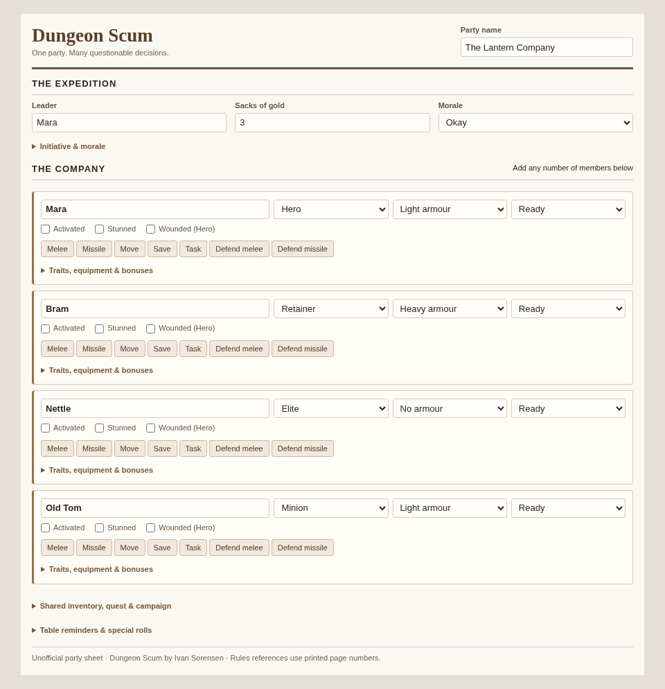

# Dungeon Scum — Roll20 party sheet

A compact, unofficial sheet based on the supplied *Dungeon Scum* rules by Ivan Sorensen. **One Roll20 character is one party**, with a repeating roster of individual members. The roster has no fixed slot count; add, remove and reorder members using Roll20's repeating-section controls. Practical browser/Roll20 limits still apply.



## Install in Roll20

Custom sheets require a Roll20 account/game with custom-sheet access (normally the game creator's Pro subscription).

1. Open your game's **Settings → Game Settings**, select **Custom** for the character sheet, and use **CSS Styling Enhancements (CSE)** rather than legacy styling.
2. Paste the complete contents of `dungeon-scum.html` into the HTML/Layout editor, and `dungeon-scum.css` into the CSS editor. There is no translation file or external asset dependency. The sheet worker is included in the HTML.
3. Save, launch the game, and create a character named for the party. Open its sheet and add roster members using **Add**. The screenshot uses sample names; the installed sheet starts empty.
4. Enter the leader, gold and members. Select each member's level and armour, then enter traits and relevant bonus dice inside their expandable details. Set **Our leader alive** and the other party factors to match the encounter.

`sheet.json` is metadata for a sheet-directory submission; the custom editor only needs the HTML and CSS. No Roll20 Mod/API script, npm install, server or secret is needed.

## During play

- Each member's visible row has name, level, armour, condition, activation, stun and wound flags, plus roll buttons. Details hold traits/personality, weapons, gear, spells, background and injury/advancement notes.
- **Melee/Missile/Task:** enter currently applicable bonus dice before rolling. Bonuses are not inferred from free-text traits. Stun subtracts one die. Minions cannot gain normal attack bonus dice; use **Volley** for a qualifying Minion warband.
- **Defence:** armour dice are automatic; the button prompts for other defensive dice. Roll separately, then subtract successes from the attack's successes and apply the result manually.
- **Move:** the inline roll is a raw dice total, **not movement distance**. Hover over it in chat to see individual dice, then apply the highest die, doubles/triples, no-armour conversion, stun discards, movement bonus and terrain costs. The chat message repeats these steps. Warbands instead use the middle of 3d6. Running like a fool and other special moves require manual/custom rolls.
- **Save:** looks for sixes, with an optional GM-awarded die. The GM still decides eligibility.
- **Initiative/morale:** expand the party controls. Counts are manual and are not inferred from the roster. For initiative, enter enemy casualties **this turn**; reset them each turn. For morale, use friendly casualties over the **whole battle**. Down and horrible-death counts are distinct; don't count one casualty in both. Enemy leader Down grants a noncumulative +2 initiative modifier: omit that leader from the ordinary initiative casualty counts. Living leader gives −1 Fear, with another −1 if they have a leadership trait. Other traits modifying the morale die go in the separate bonus field. These rolls do not use Roll20's token turn tracker.
- **Conditions:** buttons report rolls but don't enforce action eligibility. Down, dead or absent members must not act. A Stunned member cannot shoot; spell eligibility depends on school and armour. Wounded and Stunned are independent flags: a Hero's wound also causes a stun, but recovering from stun does not remove the wound. Update conditions, activation and morale manually.
- **Fumbles:** attack buttons count successes, but do not detect fumbles. Hover over the inline roll to inspect natural ones; no successes plus at least one natural one fumbles. Defence cannot turn a successful attack into a fumble. Resolve fumble tables from the rulebook.
- **Magic:** record spells, school and uses in each member's details. Custom pool can roll spell dice; it does not implement casting restrictions, school-specific mechanics, spell effects or expenditure. Keep the rulebook at hand.
- Party-wide notes hold shared loot, quest clues and campaign/house-rule notes. Individual gear capacity is recorded manually; the sheet does not impose limits or automate advancement.

## Rule decisions

The detailed chapters take precedence over the brief p.89 summary where they disagree:

| Mechanic | Implemented rule | Printed pages |
| --- | --- | --- |
| Movement pools | Minion/Elite 1d6, Retainer 2d6, Hero 3d6 | 13 |
| Movement interpretation | Highest; doubles +1, triples +2; **no armour** treats ones as twos; Stunned discards fives/sixes (manual) | 13–14 |
| Base attack pools | Minion/Elite/Retainer 2d6, Hero 3d6 | 16, 19 |
| Missile maximum | 2 / 3 / 3 / 5 dice; stun penalty applied after the cap | 16–18 |
| Melee maximum | Minions 2; **no cap for others** | 19 |
| Armour defence | None 0; Light 1; Heavy **2 melee, 3 missile** | 17, 19, 27–28 |
| Saving throw | 1 / 2 / 3 / 4 dice; a six succeeds | 24 |
| Tasks | 2 dice, +1 for Hero, plus applicable bonuses, −1 while Stunned | 18, 39 |
| Initiative | d6 + enemy Down + 2 per horrible death + leadership traits + enemy leader bonus − heavy-armour penalty | 11 |
| Morale | Must beat Fear; failure drops one morale stage | 23 |

The PDF has four character categories (including Elite); all four are supported. Only short play reminders are included, not a copy of the rulebook or its tables/art. The uploaded PDF is not bundled.

## Validation

From this checkout:

```sh
cd /workspace/dungeon-scum
node tests/worker.test.cjs
node tests/markup.test.cjs
node tests/layout.cjs
```

Worker and markup checks require only Node.js. The optional layout check uses Playwright plus `/usr/bin/chromium` (override with `CHROMIUM_PATH`); both are available in this workspace. It creates `screenshot.png` with four example members, verifies controls don't overlap at 960px and 620px viewport widths, and checks expand/collapse behavior. This is a browser-rendered preview, not a screenshot from Roll20.

Worker tests exercise class pools, missile caps, stun, armour, hydration on sheet-open and isolation between repeating rows. They mock Roll20's worker APIs; they do not prove Roll20 integration.

### In-platform acceptance check

Roll20 was not available for testing here. After installation:

1. Add a Hero and a Minion, close/reopen the sheet, and verify their values persist. Reorder them and delete a temporary third row; the other members should retain their own attributes.
2. Give the Hero +4 melee and missile dice: melee should roll 7d6, missile 5d6. Mark Stunned: these become 6d6 and 4d6; do not use the missile action while Stunned. Minion attack bonuses should not increase its pool.
3. Check Heavy armour rolls 2 defence dice in melee and 3 against missiles before prompted extras. Check Save uses 4 dice for Hero and 1 for Minion, counting only sixes.
4. Try Move and inspect its individual dice on hover. Check an initiative and morale roll against manually tallied factors. Verify output uses the current member's name, not another row's.
5. Share the party character with the intended controllers and verify they can edit and roll. Party-controlled tokens can use separate token names; per-member HP bars/individual character journals are not provided by this party model.

This implementation has passed local tests; live chat-roll syntax, Roll20 sanitization, repeating-section persistence and platform styling still need this acceptance check.
